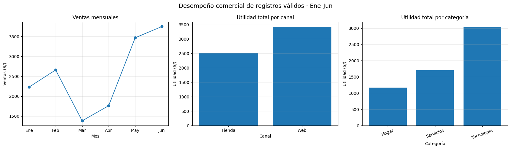

# Análisis de ventas con Python | UPC

Proyecto académico de **analítica comercial reproducible**, desarrollado como trabajo final del curso **Python for Data Science** de la especialización **Data Science for Business** (UPC).

## Objetivo

Responder: **¿Cómo evolucionaron las ventas y qué canal y categoría muestran el mejor desempeño entre enero y junio?**

El ejercicio parte de **12 registros de ejemplo proporcionados en la actividad académica**. No representa transacciones reales de una empresa.

## Herramientas

- **Python**: funciones propias, condicionales, bucles y validación de registros.
- **pandas**: DataFrames, filtros, columnas calculadas, `groupby` y `agg`.
- **NumPy**: operaciones vectorizadas e indicadores comerciales.
- **Matplotlib**: gráficos de ventas mensuales, utilidad por canal y por categoría.
- **Jupyter Notebook / Google Colab**: análisis documentado y reproducible.

## Flujo de análisis

1. **Carga e inspección:** creación de DataFrame e identificación de estados.
2. **Control de calidad:** reglas para conservar solo registros aprobados con ventas y clientes positivos; registro de exclusiones con motivo.
3. **Indicadores:** ventas totales, utilidad total, venta promedio y ventas superiores al promedio.
4. **Transformación:** cálculo de utilidad, margen porcentual y ventas por cliente.
5. **Agregación:** resúmenes por canal, categoría y mes.
6. **Visualización y conclusiones:** análisis de tendencias y recomendaciones comerciales.
7. **Consistencia:** validaciones con `assert` entre los indicadores globales y los resúmenes.

## Resultados destacados

- **10 registros válidos y 2 excluidos**, conforme a las reglas de calidad.
- **Web** es el canal con mayores ventas acumuladas en el ejemplo, con **S/ 8,490**.
- **Tecnología** es la categoría con mayor utilidad acumulada, con **S/ 3,040**.
- Junio registra las mayores ventas mensuales válidas del periodo, con **S/ 3,750**.

Los resultados corresponden exclusivamente al conjunto de datos de la actividad y **no deben extrapolarse a operaciones comerciales reales**.

## Gráficos



## Cómo ejecutar

**Google Colab:** abre [`analitica_comercial_python.ipynb`](analitica_comercial_python.ipynb), descárgalo y súbelo a [Google Colab](https://colab.research.google.com/). Ejecuta todas las celdas en orden.

**Entorno local:** instala Python y Jupyter, y ejecuta:

```bash
pip install -r requirements.txt
jupyter notebook analitica_comercial_python.ipynb
```

## Archivos

```text
analitica_comercial_python.ipynb  # Notebook del análisis
requirements.txt                 # Dependencias mínimas
assets/graficos_desempeno.png    # Visualización para el README
README.md                        # Documentación del proyecto
```

## Alcance y limitaciones

Este es un **ejercicio académico** de nivel introductorio/intermedio con un dataset pequeño. Demuestra limpieza, análisis exploratorio y elaboración de indicadores en Python, pero no implementa una canalización ETL productiva, una base de datos ni despliegue en la nube.

**Autor:** Marko Naveda. Se ha preparado una versión pública del notebook que omite el código académico del alumno y una nota privada del trabajo presentado; el código de análisis permanece intacto.
